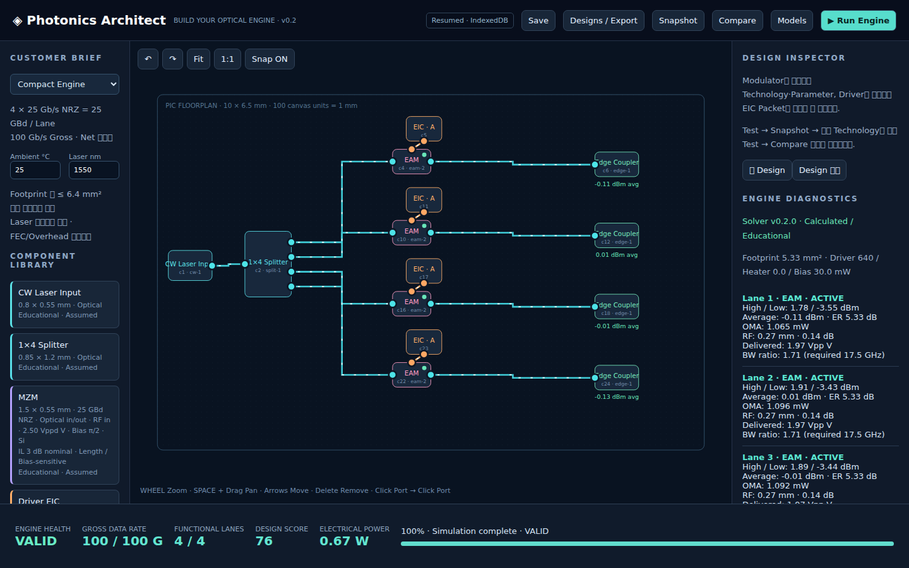
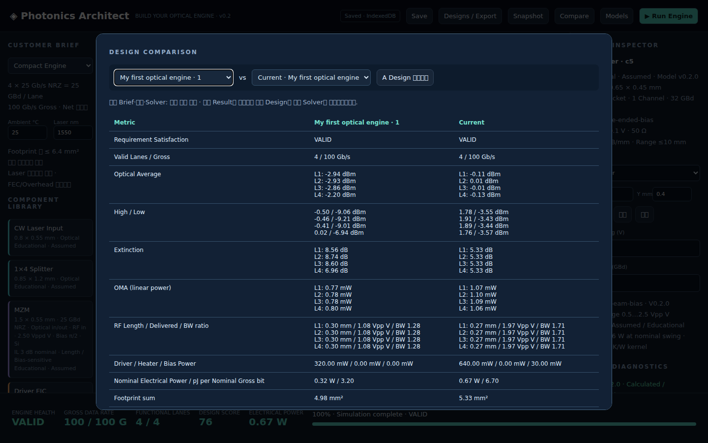

# Photonics Architect v0.2.0

Build your 100G Optical Engine with MZM, MRM or EAM and a compatible Generic EIC Packet. Place → Connect → Test → Diagnose → Compare → Improve. v0.1 Design Studio remains; v0.2 adds device response differences, bounded thermal tuning, Customer Briefs and saved-design comparison.

## Offline play

Download [photonics-architect-v0.2.0.html](dist/photonics-architect-v0.2.0.html), then open locally in a desktop browser. No server, CDN or network required. Four 25 Gb/s NRZ lanes = 25 GBd/lane; Net Throughput is not modeled.

Choose First, Compact or Stable; place Laser, 1×4 Splitter, Modulators, Driver Packets and Edge Couplers. Click compatible ports to wire. Move Driver to explore RF and thermal effects. Select Modulator for Length/Bias/Resonance/Heater/Technology, Driver for Packet/Swing. Technology swaps keep net IDs. Test, Snapshot, build another alternative and Compare. Compact supports at least MRM and EAM; Stable examines nominal plus four temperature/wavelength corners.

Wheel zoom, Space+drag pan, arrow keys (Shift finer), numeric positions, Rotate, duplicate, Lane duplicate, delete, Undo/Redo and photon/RF animation remain. Canvas/HUD stay fixed; panels and dialog scroll internally. IndexedDB autosaves and resumes; named Save/Load and backup recover. Legacy v0.1 schema migrates; paste JSON provides portable import. Export JSON includes schema/solver/model IDs; PNG floorplan and Engineering Summary are available. Export before switching file paths/browser profiles because file-origin storage policies vary.

## Engineering scope

All numerical parameters are Educational Assumptions. Models are separate from UI and deterministic. MZM phase/VπL, MRM resonant through-port/detuning/heater limits, EAM voltage absorption; RF geometry/attenuation/stage response; simple location thermal kernel and Driver/Heater/Bias power. External Laser electrical power is excluded. No Eye/BER, full-wave, PDK DRC/LVS, GDS or validated thermal solver.

[Model equations / Primary Sources](docs/MODELS_V02.md) · [Schema / Migration](docs/COMPONENT_SCHEMA.md) · [Game design](docs/GAME_DESIGN.md) · [Test evidence](docs/TEST_REPORT.md) · [Handoff](docs/HANDOFF_v0.2.0.md).

## Develop / verify

Node 20+, dependency-free ES modules/SVG (JavaScript, not TypeScript).

```sh
npm test
npm run build
python scripts/package.py
```

Browser suites require Playwright 1.62.1 and installed Chromium. Run `node tests/browser.cjs` and `node tests/codesign-browser.cjs`. `CODEX_PRIMARY_RUNTIME_NODE_MODULES` may point to shared modules; `BROWSER_EXECUTABLE` is optional. Serve source over localhost; standalone file needs no server.

Baseline v0.1: `c0a54d30c670d9dd1024d7cf7702df6b066bb90f`, PR #1 unmerged. v0.2 branch: `feature/v0.2-modulator-eic-codesign`. No automatic merge, tag or formal release.



