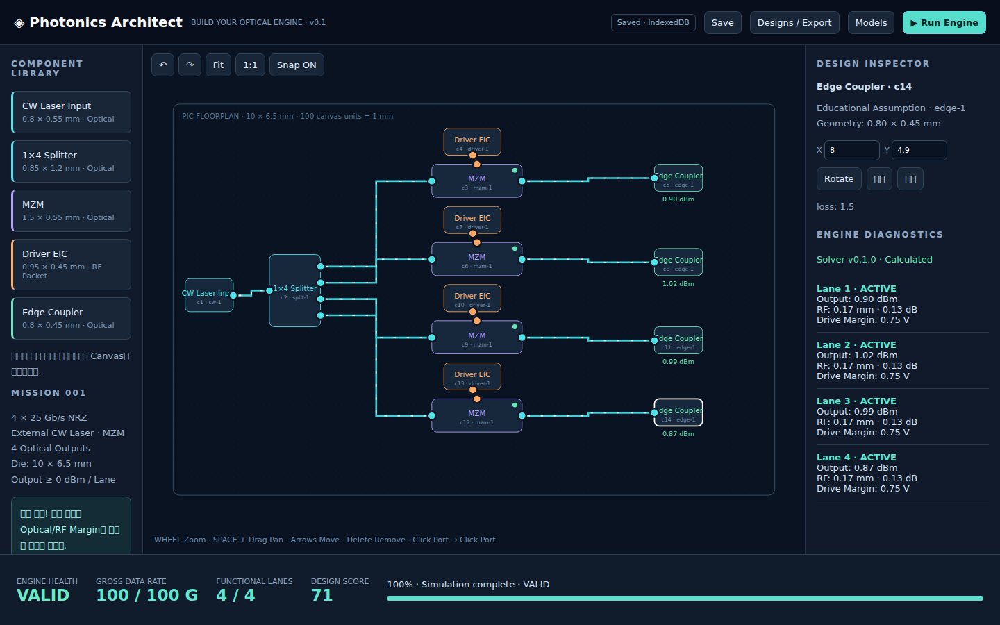

# Photonics Architect v0.1.0

Build a 4 × 25 Gb/s NRZ Optical Transmitter by placing and wiring a CW Laser, 1×4 Splitter, four MZMs, Driver EICs and Edge Couplers. Placement changes optical and RF performance. This is an educational engineering game with generic assumptions, not a foundry design tool.

## Play

Download `dist/photonics-architect-v0.1.0.html` and open it locally. No server, CDN or installation required. Use the component palette, then click on the floorplan. Connect matching ports by clicking each endpoint. Duplicate a lane's components, then wire them yourself. Run the engine and click diagnostic issues to inspect the affected components.

Canvas and the Engineering HUD remain visible; side panels scroll independently. Wheel zooms, Space + drag pans, arrows move selected components (Shift for 0.01 mm increments), Delete removes selection, Ctrl+Z undoes. Inspector supports numeric placement, rotation, duplicate and lane duplication. Click a net to delete it. Save/Resume uses IndexedDB; JSON paste import/export provides portable backups. Browsers can isolate or clear file-origin storage: export important designs before moving the HTML or switching profiles.

## Develop

Requires Node 20+. Zero runtime dependencies, ES modules and SVG. The v0.1 implementation deliberately uses dependency-free JavaScript rather than TypeScript/React/Pixi; the small graph and 2D scene do not need a framework. `npm test` runs physics/graph unit tests; `npm run build` embeds modules and CSS into the standalone HTML. For source development, serve the repository over localhost; standalone needs no server.

Browser tests need Playwright: `npm install --no-save playwright` and `npx playwright install chromium`, then `node tests/browser.cjs`. Optional `BROWSER_EXECUTABLE` selects an installed Chromium. Tests must run from the repository root. The runtime used for verification provided Playwright; no dependency download was required locally.

## Release candidate

Baseline: main `fa0383207a191b6c9a7b3ae749bf210f2137a467` (initial README). Branch: `feature/v0.1-first-optical-engine`. Main merge, tag and formal release require owner approval.

See [Test report](docs/TEST_REPORT.md), [Simulation models](docs/SIMULATION_MODELS.md), [Roadmap](docs/ROADMAP.md). Offline HTML and source/release ZIPs are in `dist/`; SHA-256 manifest identifies exact files.

